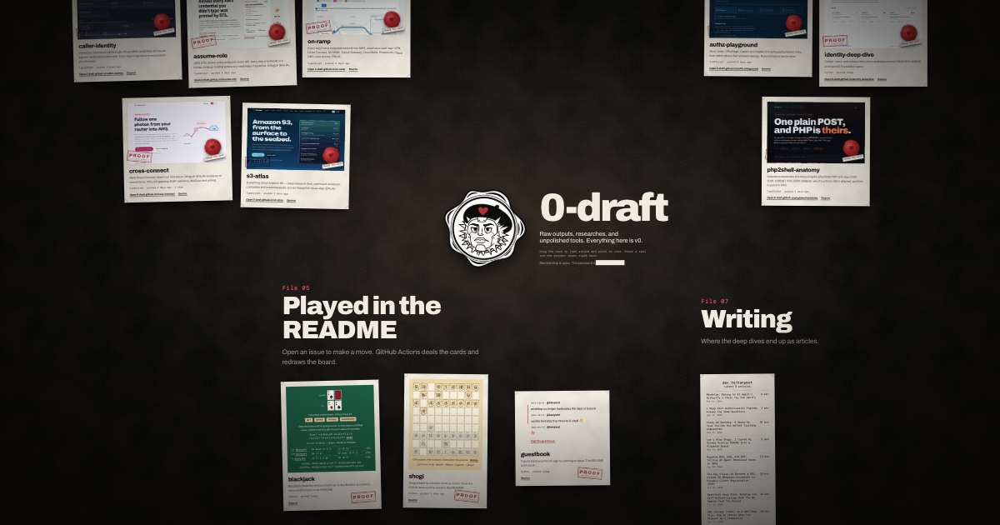

# 0-draft.github.io



Everything public in the [0-draft](https://github.com/0-draft) org, pulled as proofs and laid out on a print-shop desk at night: <https://0-draft.github.io/>.

Drag the desk to look around and pinch (or press `+` and `-`) to zoom. Break the wax seal on a sheet and the real site opens right on the desk. Blackjack, shogi and the guest book are read live from their READMEs, so you can make a move from here. Prefer a plain page? Press "List view".

## How it works

- `scripts/sync.ts` pulls the org's public repos (archived repos and forks are left out), the live region of each README game, and the latest dev.to articles into `src/data/`. A source that fails keeps its previous file.
- `src/data/groups.ts` decides which pile a repo sits in. A new repo that isn't filed there shows up on its own pile on the next build.
- `src/lib/desk.ts` holds where each sheet sits on the desk. `src/scripts/desk.ts` is the camera: pan, zoom, the minimap and the live frame. It has no dependencies.
- `src/assets/shots/` holds a screenshot per project, named after the repo. `scripts/shoot.ts` takes the missing ones; `--all` retakes every one.

## CI

- `ci.yml` runs on every pull request: Biome, actionlint, `astro check`, Vitest, a build, and Playwright against that build in Chromium, WebKit, a phone and with JavaScript off.
- `deploy.yml` runs the same CI on freshly synced data on every push to main and once a day, then deploys to Pages.
- `claude-review.yml` reviews pull requests. It needs a `CLAUDE_CODE_OAUTH_TOKEN` secret from `claude setup-token`.
- `shots.yml` takes screenshots for new live sites every Monday and proposes them as a pull request. Run it by hand with "retake all" after the sites change.
- Dependabot proposes npm and Actions updates every Monday, grouped and held for three days after release.

## Develop

```sh
pnpm install
pnpm sync      # needs network; set GITHUB_TOKEN to avoid rate limits
pnpm dev
pnpm check     # biome + astro check
pnpm test      # vitest
pnpm build
pnpm e2e       # playwright against dist/
```

Astro 7, plain CSS, Node 24 or newer.

## Adding a repo

1. Add its name to a group in `src/data/groups.ts`.
2. Give it a spot in `src/lib/desk.ts`.
3. Run `node scripts/shoot.ts`, or wait for the weekly shots workflow, to get its screenshot at `src/assets/shots/<repo>.png`.
